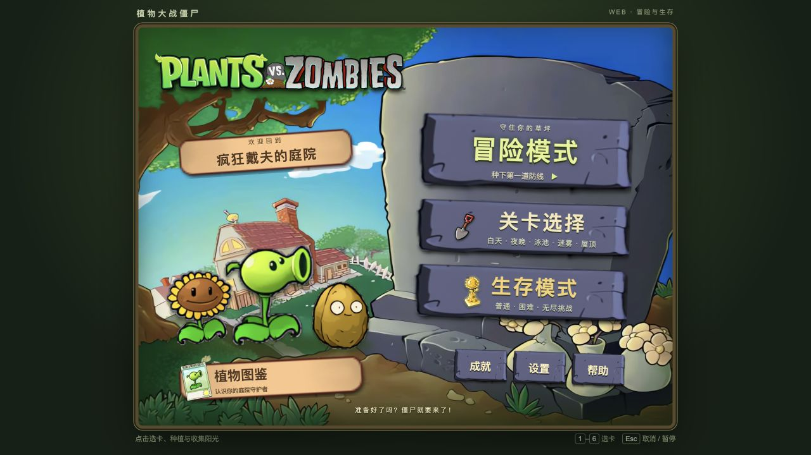
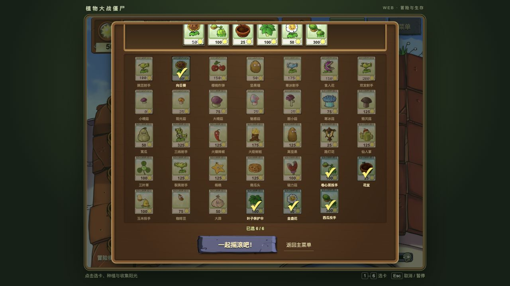
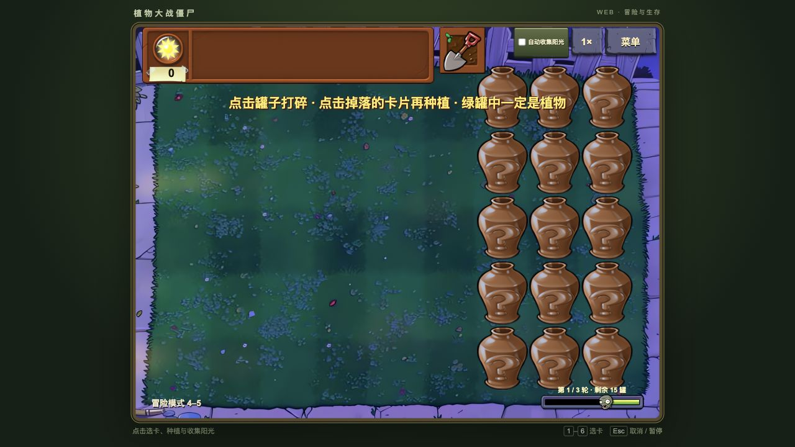
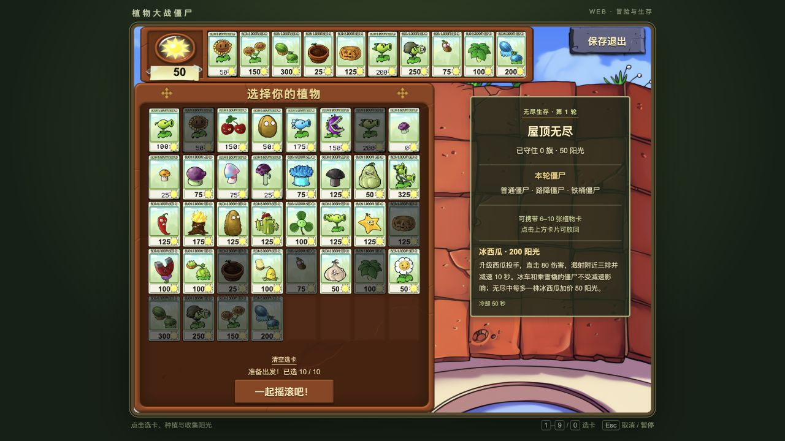
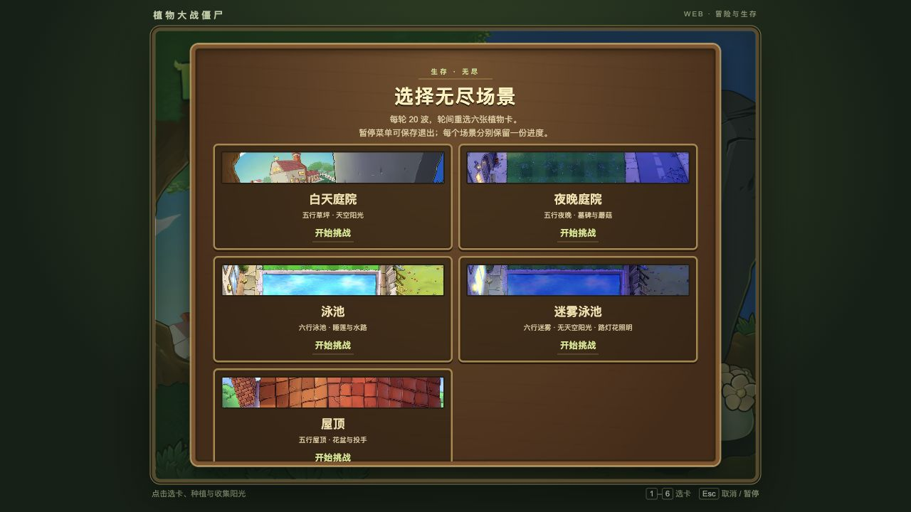
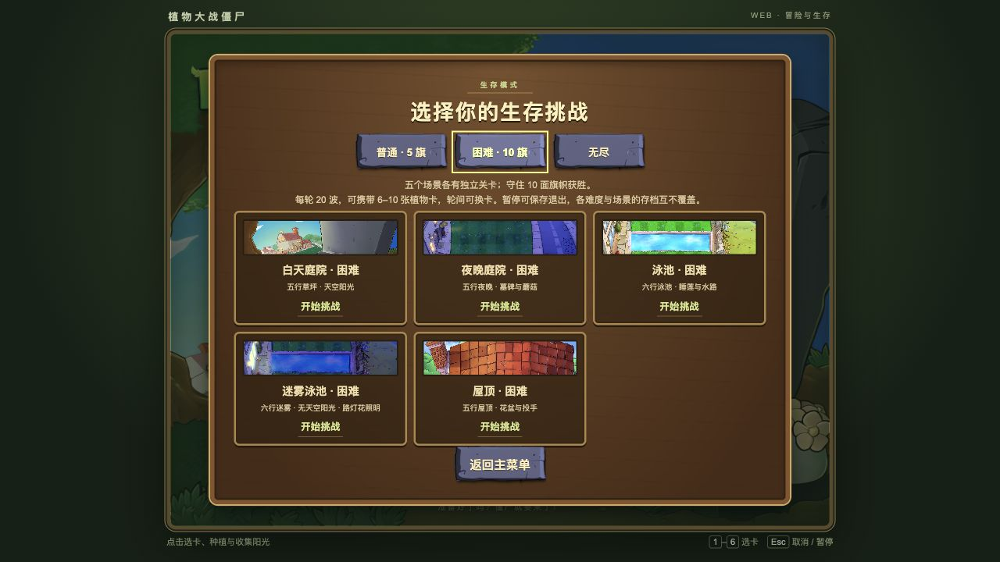
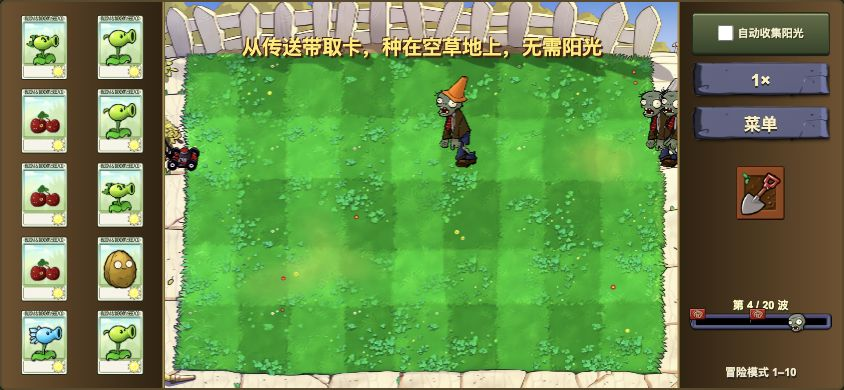

# 植物大战僵尸 Web

用 TypeScript 和 PixiJS 构建的《植物大战僵尸》Web 移植项目，在浏览器中种植植物、收集阳光、守护庭院。

开放 50 个冒险关卡，包括僵王博士挑战；新增普通与困难生存共 10 关，加上五种场景的无尽生存，覆盖白天、夜晚、泳池、迷雾和屋顶。生存模式支持轮间换卡、暂停、独立保存与继续挑战。

支持冒险六槽与生存十槽选卡、机枪射手、双子向日葵与冰西瓜升级、全部关卡开放开关、成就、倍速、阳光落地后自动收集、背景音乐、植物与巨人的部件插值动画和 2 倍高清素材。资源按需加载，可通过 PWA 安装到桌面，并缓存资源离线游玩。

手机横屏采用两侧操作栏，支持从设置或暂停菜单进入全屏，也可开启僵尸血条。

**[在线游玩](https://pvz-web-khaki.vercel.app/)**

## 技术栈

| 技术 | 用途 |
| --- | --- |
| TypeScript | 游戏逻辑与交互 |
| PixiJS 8 | 2D 场景与动画渲染 |
| Vite 7 | 开发与构建 |
| HTML / CSS | 菜单与游戏 HUD |
| Web Audio API | 背景音乐与音效 |
| PWA / Service Worker | 应用安装与离线缓存 |
| Vercel | 网站部署 |

## 游戏截图

### 主界面

### 六槽选卡

### 砸罐子关卡

### 无尽十槽选卡

### 无尽生存

### 普通与困难生存

### 手机横屏

