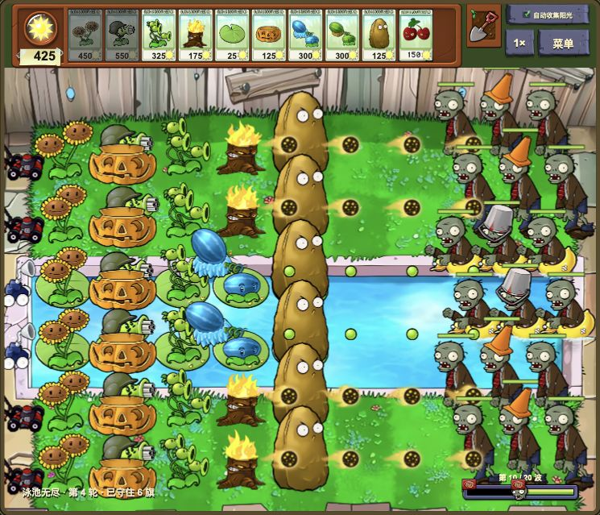
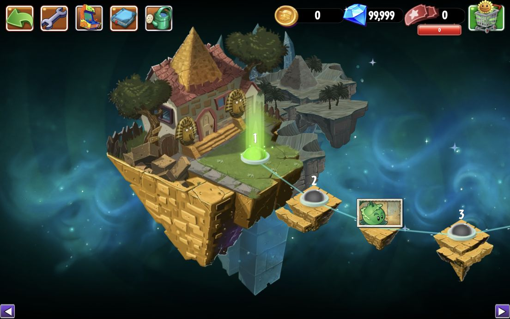
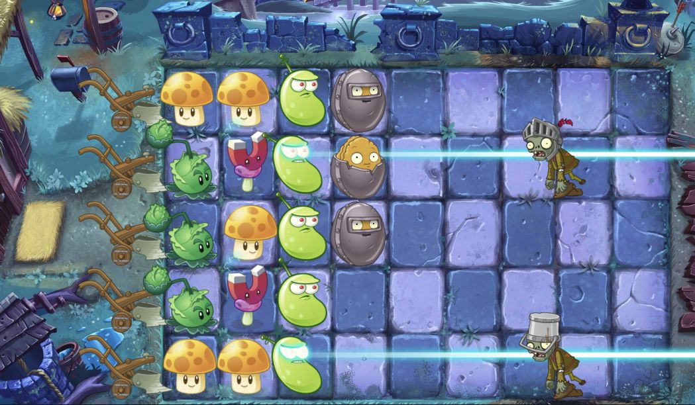

# 植物大战僵尸 Web · PVZ1 & PVZ2

在浏览器里种下向日葵，搭起防线，迎接下一波僵尸。

用 TypeScript 与 PixiJS 重写游戏逻辑和渲染，让经典庭院与二代时空冒险在同一个站点游玩。两代游戏独立开发、独立存档，也可以分别安装为 PWA。

**[游玩 PVZ1 →](https://pvz-web-khaki.vercel.app/)** · **[游玩 PVZ2 →](https://pvz-web-khaki.vercel.app/pvz2/)**

## 两代游戏，各自完整推进

| | PVZ1 · 经典庭院 | PVZ2 · 时空冒险 |
| --- | --- | --- |
| 当前进度 | 50 个冒险关卡 | 175 个主线关卡已接入，持续迁移中 |
| 场景与世界 | 白天、夜晚、泳池、迷雾、屋顶 | 埃及、海盗、西部、未来各 35 关，黑暗时代 1–30 关、沙滩 1–5 关 |
| 主要玩法 | 保龄球、打僵尸、砸罐子、雷雨之夜、僵王战；五种场景的普通、困难与无尽生存 | 世界地图选关、传送带、预布阵、限损与保护目标、植物大招、各世界特殊机制与僵王战 |
| 进度与养成 | 生存模式保存退出，按场景和难度继续；升级植物、轮间换卡与成就 | 地图解锁、植物奖励、图鉴、禅境花园、本地商店与自由选关 |

PVZ1 支持冒险六槽、生存最多十槽选卡，以及倍速、自动收集落地阳光和可选僵尸血条；适配电脑与手机横屏。PVZ2 保留上游世界地图的浮岛、连线、关卡节点和奖励展示，支持拖动、滚轮与方向键浏览，战斗支持二倍速。

PVZ2 以固定版本的 [PvZ2 Gardendless](https://github.com/Gzh0821/pvzge_web) 为还原基准。已接入关卡仍有动画、音效和交互细节待对齐，支线、无尽及后续世界战斗尚未全部接入。每批验证条件与已知差异见 [迁移记录](apps/pvz2/FIDELITY.md)。

## 游戏画面

以下为本项目的实际渲染截图。

### PVZ1 · 疯狂戴夫的庭院


### PVZ1 · 泳池无尽

十槽卡组、升级植物与动态火豌豆。



### PVZ2 · 神秘埃及地图

原世界浮岛、关卡路径、植物奖励卡与本地货币栏。



### PVZ2 · 黑暗时代战斗

第 22 关的场景回放，展示激光豆攻击、磁力菇与坚果铁甲；使用实际战斗模型和渲染器。



## 项目的特点

### 按当前场景加载资源

地图、关卡和角色资源按需加载。PVZ2 首屏准备世界选择与共用 UI，进入世界后再加载对应地图，进入关卡时动态导入战斗代码，并按本局植物与僵尸准备素材。纹理在加载阶段预上传，地图与战斗切换时管理各自的动画时钟和渲染资源。

PVZ2 直接使用提取后的地图数据、图集与骨骼，在 TypeScript 中实现游戏行为，无需运行上游的 Cocos、Bullet、Spine WASM。两版均采用 PixiJS 渲染，加载优化随各自应用演进。

### 两代独立，便于继续扩展

PVZ1 位于根项目，PVZ2 位于 `apps/pvz2/`。两者各自维护游戏逻辑、素材、依赖与测试，通过页面跳转切换；复用固定步长模拟、模型与渲染分离、按需加载等设计。新增二代世界可以在 PVZ2 内完成，不需要改动一代玩法。

### 可以离线，也能自己决定何时更新

两版有独立的 PWA 标识、缓存和更新管理。启动只预缓存入口等必要文件，其余资源按访问缓存；需要完整离线游玩时，可手动下载离线资源。更新按文件哈希复用未变化的素材，新版本就绪后由玩家选择何时重新加载，存档保留在本机。

安装与更新入口、缓存隔离方式及浏览器验证范围见 [PWA 文档](docs/PWA.md)。

### 还原过程可以核对

PVZ1 使用原版风格的素材、HUD 与角色部件插值动画。PVZ2 读取固定上游版本的关卡配置、DragonBones 骨骼及事件帧，逐步接入对白、音效和战斗机制。资源提取脚本与输入／输出哈希保存在仓库中，迁移记录明确区分已验证内容和待完善部分。

游戏模型与渲染分离，既能用自动化回放检查关卡规则和通关路径，也能在浏览器中核对实际表现。关卡迁移按批推进，保留可重复的测试与验收入口。

## 技术栈

| 技术 | 在项目中的用途 |
| --- | --- |
| TypeScript | 两代游戏规则、固定步长战斗模拟、存档与交互 |
| PixiJS 8 | 2D 场景、图集、角色绘制、战斗特效与纹理预上传 |
| 部件插值动画／DragonBones | PVZ1 角色部件动画；PVZ2 通过 `pixi-dragonbones-runtime` 播放骨骼动画和事件帧 |
| HTML / CSS | 菜单、选卡、HUD、设置与响应式布局 |
| Web Audio API／HTML Audio | PVZ1 的音乐与音效；PVZ2 的音乐、角色语音与音效 |
| Vite 7 + pnpm workspace | 双项目开发、动态导入与独立构建，再组合为同一站点 |
| Service Worker + Web App Manifest | 独立 PWA 安装、离线资源管理与按版本更新 |
| Node.js Test Runner + tsx | 游戏规则、关卡回放、地图进度及 PWA 测试 |
| Python 资源工具 | 素材提取、图集处理、字体子集与来源哈希记录 |
| Vercel | 静态站点部署 |

## 本地运行

需要 Node.js 24 与 pnpm 11。以下命令在仓库根目录执行：

```sh
pnpm install
pnpm dev
```

访问 `http://127.0.0.1:5173/` 游玩 PVZ1，访问 `http://127.0.0.1:5173/pvz2/` 游玩 PVZ2。开发命令同时启动两版，二代由根服务代理。

```sh
pnpm dev:pvz1       # 单独开发 PVZ1
pnpm dev:pvz2       # 单独开发 PVZ2，访问 :5174/pvz2/
pnpm test           # PVZ1 测试
pnpm test:pvz2      # PVZ2 测试
pnpm build          # 分别构建，组合输出到 dist/ 和 dist/pvz2/
pnpm preview        # 预览组合构建，包括两版 PWA
```

开发模式不注册 Service Worker；离线与更新功能使用生产构建预览。

## 继续了解

- [PVZ2 应用说明](apps/pvz2/README.md)：地图、战斗、外层功能与资源提取流程。
- [PVZ2 迁移与还原记录](apps/pvz2/FIDELITY.md)：当前关卡进度、验证条件和待修细节。
- [PWA 安装、离线与更新](docs/PWA.md)：两代应用的独立管理方式。
