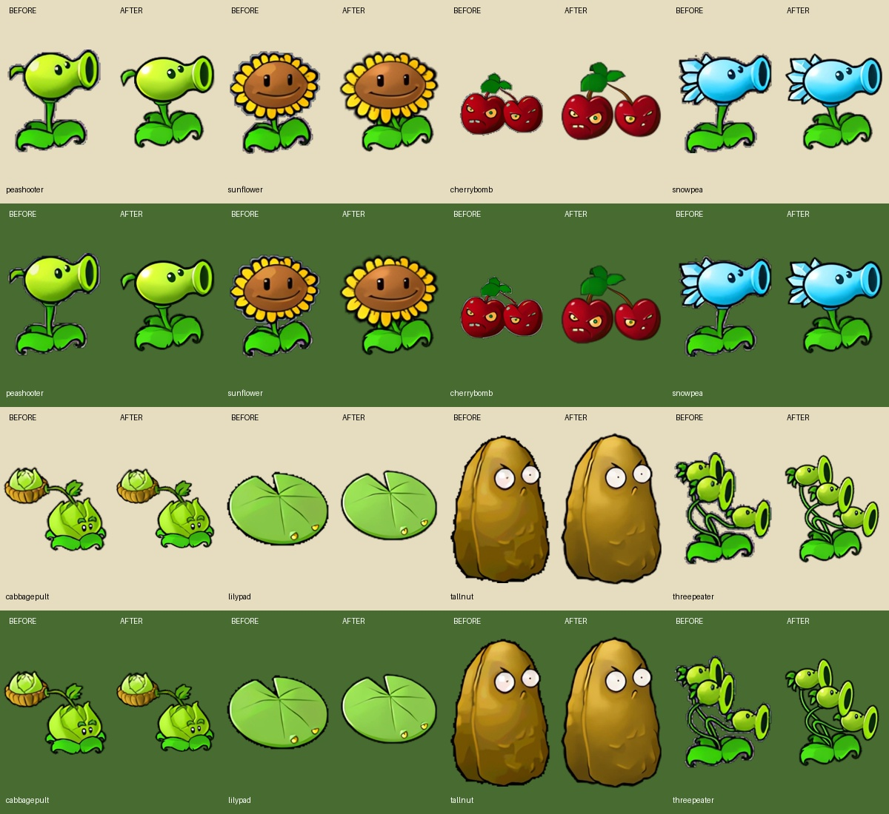

# Display-density asset review

## Refinement review — 2026-10-16

The first refinement pass inventories all 617 shipped raster images (610 runtime images and seven app icons). `asset-review-2026-10-16.json` records dimensions, sizes, hashes and changed files. Visual review covered the 110 display-HD images, static art, native part-atlas contact sheets, boss parts, icons and the first pose of each of the 181 baked clips. This is a category-wide review and first-pose inspection, not a claim that every animation frame has been visually approved.

The main confirmed defect was source quality: several plant portraits inherited jagged GIF silhouettes and gray/purple matte pixels. Upscaling those composed images enlarged the same defects. The new exporter uses the existing Pixi plant/actor/giant rigs to compose 43 plant portraits and 24 zombie portraits directly from their native parts. Rendering at four pixels per logical unit preserves subpixel transforms and transparent edges; the input parts remain 2x assets, so this does not claim recovered 4x source detail. Zombie portraits now also match the native battle designs, including dancer/backup and the swimming ducky pose.

The ordinary peashooter had an additional source mapping error: `PeaShooter.reanim` is the repeater resource. The original mapping in the pinned source repository's `Sexy.TodLib/Reanimator.cpp` assigns `PeaShooterSingle.reanim` to the ordinary peashooter. The importer now uses that file and omits the mirror's added `GatlingPea_helmet2` track. Its sprout is restored; the repeater retains its eyebrow. The existing 100-tick idle cycle and origin are unchanged. This is the only battle part atlas changed in this pass.

Reviewed exceptions remain on their existing artwork: gloomshroom, cattail, goldmagnet, spikerock, cobcannon and imitater have sharper standalone super-resolution portraits than the available Lanczos part atlases. The baked imp portrait and special explodenut art are also retained. Scene backgrounds, HUD surfaces, decorative packet lettering, effects, app icons and other battle atlases remain unchanged. Small bitmap lettering and fine grass texture still carry the limits of the original source; they were not redrawn or sharpened indiscriminately.

All 67 updated portraits are encoded directly from committed PNG masters at WebP Q97, with alpha identical to those masters. Together they grow from 1,544,392 to 2,145,908 bytes (+601,516 bytes, about 0.57 MiB). The largest output edge is 920 pixels. Their combined raw RGBA footprint grows from 26,533,248 to 42,061,760 bytes if all are decoded at once; actual browser memory also depends on caching. Existing portrait URLs and lazy loading are retained. Authoring PNGs live outside the shipped runtime directory and are excluded by the existing public-assets build plugin.

Reproduction:

1. For the peashooter source correction, run `python3 tools/import-plant-motion.py RUSLAN_REPO` against the pinned repository recorded in `plant-motion-assets.json`.
2. Start `pnpm dev`, open `/tools/portrait-export.html`, click the export button, and download its JSON. Review the rendered gallery before importing it.
3. Run `python3 tools/import-portraits.py /path/to/portraits.json`, then `python3 tools/build-display-hd.py --encode-only`. Rendered portrait targets bypass neural upscaling; other targets use the existing inference PNGs. Source-part, PNG-master and output hashes are recorded in `portrait-assets.json`.
4. `python3 tools/build-almanac-previews.py` can re-encode the 24 updated zombie portraits from those masters without returning to lossy baked atlases.

Verification: 315 tests and the production build passed. All 67 new portrait alpha channels and source hashes were checked. Browser review covered the plant/zombie almanac, seed selection, planting the corrected peashooter in a daytime battle, and the almanac at an 844×390 landscape viewport. The subsequent sections describe the earlier display-HD rollout and its historical measurements.

## Findings

- Before this change, the runtime shipped 475 WebP images. Scene backgrounds and actor parts were 2x; 11 chooser/dialog/HUD surfaces were still 1x. Source/background dimensions were checked directly with Pillow, rather than inferred from filenames.
- Full backgrounds were 2800x1200 at 2x. The renderer only displays the logical rectangle (220, 0, 800, 600). Loading a 4x version of the whole 1400px source would waste memory on hidden scenery and produce a 5600px texture.
- Native plant/zombie parts and their atlases already use 2x source resolution. They remain unchanged: multiplying all of those textures by four in memory would penalize crowded survival games. Their pose/crop coverage is exercised by the actor/plant/giant motion tests.

## Changes

- Seven cropped scenery images: unsodded yard, lawn, night, pool, fog, roof, boss. Each is 3200x2400 at 4x and preserves the exact 800x600 logical camera. Day lawn strips retain their original row positions.
- 92 DOM/HUD/background images and 11 UI surfaces have separate high-density URLs. Plant prices remain DOM text. CSS image-set selects existing or HD art by density; wide 1x desktops select HD art. DOM portraits use the new small standalone files.
- Scenery tier is selected when entering a board, using actual framebuffer pixels per simulation unit. At up to 2 pixels/unit the existing image is loaded; above that, the cropped 4x image is loaded. No background download is added to startup, no retry/failure substitution is introduced, and old URLs stay available.
- Nine-slice HUD regions use percentages so either density samples the same corners and edges.

## Costs and limits

- 110 HD images total 10,806,518 bytes (10.31 MiB); seven scenery images account for 4,453,692 bytes. The HD lawn is 962,532 bytes.
- One HD scenery texture occupies 30,720,000 RGBA bytes before driver overhead; a daytime board uses yard plus lawn. Small boards retain existing 2x resources. DOM art is loaded through the existing lazy image mechanism where present. Offline installation includes both tiers.
- Texture edges stay at or below 4096 pixels. The previous framebuffer change retains the 3840x2160 total pixel budget.
- This is super-resolution of original art, not recovered native 4K source detail. Original grass patterns, painted shading and animation geometry are retained.
- Resizing an already-loaded board keeps its selected scenery tier until the next board load.

## Reproduction and verification

Run `python3 tools/build-display-hd.py` with the existing Real-ESRGAN ncnn runtime/models in `artifacts/hd-work/runtime`. The exporter uses the x4 animevideo-v3 model, fixed tile size and explicit sources/crops in `tools/display-hd-targets.json`. PNG inference results are encoded as Q95 scenery, Q97 other surfaces, and lossless packet lettering/logo. `--encode-only` re-encodes existing inference results.

Source/output hashes, dimensions and sizes are in `display-hd-assets.json`. All 110 encoded outputs were checked against inference PNG dimensions and alpha channels. The 312-test suite and production build passed. Browser checks covered main menu, original nine-slice panels, plant selection and entering a daytime battle without console errors. A same-scale lawn comparison is saved locally at `artifacts/hd4/lawn-comparison.png` (left: former 2x image enlarged, right: direct 4x result).
